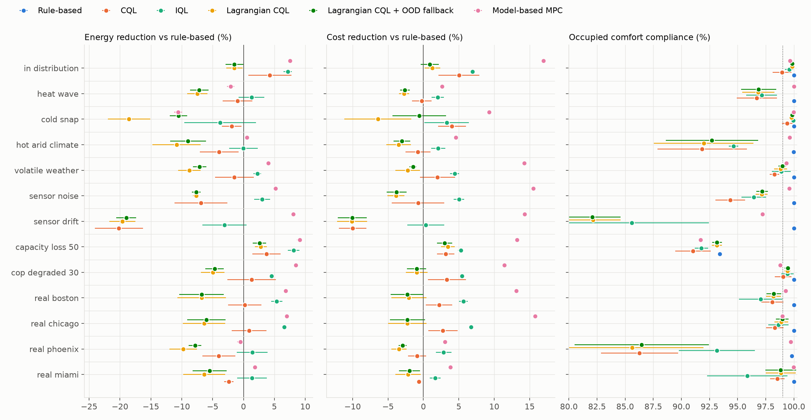

# Offline RL for Energy-Efficient Building HVAC Control

Learn an HVAC control policy **purely from logged building-management-system (BMS) data**, with no
online interaction, and check that it beats the building's rule-based schedule on energy and cost
without breaking occupant comfort, including under weather it has never seen.

* **Model-free offline RL (from scratch, PyTorch):** Behavior Cloning, Filtered BC, CQL (Q-ensemble, n-step),
  IQL, and **Lagrangian-constrained CQL** (comfort as an explicit constraint). See [agents.py](src/hvac_orl/agents.py).
* **Model-based offline RL:** bootstrap dynamics ensemble + MPC planner ([model_based.py](src/hvac_orl/model_based.py)).
* **Safety layer:** ensemble-disagreement OOD detector with rule-based fallback ([safety.py](src/hvac_orl/safety.py)).
* **Off-policy evaluation:** FQE, per-decision WIS, weighted doubly-robust, used for policy selection without a simulator ([ope.py](src/hvac_orl/ope.py)).
* **Extras:** 3-zone building with parameter-shared policy ([multizone.py](src/hvac_orl/multizone.py)), demand charges,
  real EPW weather (Boston, Chicago, Phoenix, Miami), equipment faults, dataset size/quality ablations,
  explainability (permutation importance + distilled decision trees), Sinergym/EnergyPlus transfer adapter.
* **Baseline:** a typical commercial BMS schedule (22 °C occupied setpoint, 1 h pre-start, night setback).
* **Evaluation:** Monte Carlo rollouts (500 days per scenario) in a building simulator, paired across
  policies (every policy sees the exact same days), with 3 training seeds and bootstrap CIs.
* **Robustness:** 12 out-of-distribution scenarios: heat wave, cold snap, hot-arid climate, volatile weather,
  sensor noise, sensor drift, 50% capacity loss, degraded COP, and 4 real TMYx climates.

Full write-up: **[REPORT.md](REPORT.md)**.

## Results

See [results/summary.md](results/summary.md) and [results/figures/](results/figures/) after running the pipeline.

### Headline (in-distribution test days, 500 days × 3 training seeds, vs the rule-based BMS schedule)

| Policy | Energy saved | Cost saved (95% CI) | Peak demand cut | Comfort compliance |
|---|---|---|---|---|
| Rule-based BMS | – | – | – | 100.0% |
| **Model-based MPC** | **7.6%** | **17.0% (15.5–18.4)** | **25.7%** | **99.7%** |
| IQL | 7.2% | 6.9% (6.2–7.6) | 10.9% | 99.6% |
| CQL | 4.3% | 5.0% (4.3–5.8) | 9.7% | 99.0% |
| Lagrangian CQL | −1.5% | 1.3% (0.5–2.1) | 4.9% | 99.9% |
| IQL + OOD fallback | 6.5% | 5.9% (5.3–6.5) | 8.5% | 99.7% |
| Filtered BC | 0.7% | 1.1% | 1.9% | 98.4% |
| BC | 14.6% | 12.2% | 11.4% | **71.6%** ✗ |

**Robustness (12 unseen scenarios):** MPC keeps an average **10.1% cost saving** (3.2% energy) with
≥ 97% comfort everywhere except 50% capacity loss (91.7%, where the rule-based schedule itself only reaches 93.4%).
Model-free agents lose most of their advantage OOD and drop to 72–86% comfort under a +1 °C sensor drift.

**Off-policy evaluation (35 candidate policies):** FQE ranks policies well (Spearman 0.82) and its top pick is
within 0.02 of the best true value; importance sampling fails at this horizon (PDWIS Spearman 0.33).

**EnergyPlus transfer (zero-shot, Sinergym 5-zone office, full year):** IQL keeps a 4.9% cost saving but drops to
94% comfort (rule: 99.7%), and MPC drops to 89%. Policies learned from one building's logs need the target
building's own data, as shown in [REPORT.md §4.7](REPORT.md).



Details: [results/summary.md](results/summary.md), [REPORT.md](REPORT.md).

## How it works

### Building simulator ([building.py](src/hvac_orl/building.py))
A single-zone office modeled as a **2R2C thermal network** (indoor air/furniture node + envelope node),
integrated with 1-minute substeps inside 15-minute control steps.

* **Action:** one of 10 discrete choices: HVAC off, or zone setpoint ∈ {17, 19, 20, …, 25, 27} °C. A
  capacity-limited P-controller tracks the setpoint (so, like real equipment, the zone settles slightly off setpoint).
* **Energy:** heat-pump electricity = thermal energy / COP(T_out) plus 1.5 kW fan power whenever HVAC runs.
* **Cost:** time-of-use tariff (peak 12–20 h weekdays $0.28/kWh, shoulder $0.15, off-peak $0.09) plus a
  demand charge of $0.5/kW on each day's peak (billed incrementally so the problem stays Markov).
* **Comfort:** occupied (weekdays 7–19 h) band 20–24 °C; unoccupied protection band 15–30 °C.
* **Reward:** −(cost + $2 per °C of occupied comfort violation per step + $0.5 per °C unoccupied).
* **Observation (13-d):** indoor temp and its 15-min change, outdoor temp, solar, time of day (sin/cos), occupancy,
  weekday, hours to occupancy start, current and next-2h price, 3-hour outdoor temperature forecast, peak kW so far today.
  The envelope temperature is hidden (partial observability, as in a real BMS).

### Weather ([weather.py](src/hvac_orl/weather.py))
A parametric generator: seasonal + diurnal cycles, day-to-day synoptic offsets, AR(1) noise, and solar
irradiance driven by day length and daily cloudiness. Real EPW (TMYx) files are used for the real-climate tests
(`scripts/download_weather.py`). OOD scenarios are parameter changes
([scenarios.py](src/hvac_orl/scenarios.py)).

### Offline dataset ([data.py](src/hvac_orl/data.py), [controllers.py](src/hvac_orl/controllers.py))
2,000 logged building-days (192k transitions) from a heterogeneous behavior policy that imitates years
of real BMS operation: rule schedules with different setpoints and pre-start times (different facility
managers), deadband/free-float days, sticky operator overrides, and ~15% commissioning/test days with random actions.

### Experimental hygiene
* Separate seeds for **data**, **validation** (hyperparameter selection), and **test** (reported numbers).
* The **final** checkpoint is evaluated; no checkpoint picking on test.
* Common random numbers: all policies are evaluated on identical days, so differences are paired.

## Reproduce

```bash
python3 -m venv .venv && .venv/bin/pip install -r requirements.txt && .venv/bin/pip install -e .
.venv/bin/python -m pytest -q tests
./scripts/run_all.sh          # tests → weather → data → train (3 seeds × 6 methods) → evaluate → OPE → multi-zone → ablations → explain
```

Individual steps:
```bash
.venv/bin/python scripts/generate_data.py --days 2000
.venv/bin/python scripts/train.py --algo iql --seed 0 --steps 100000
.venv/bin/python scripts/evaluate_all.py --days 500
.venv/bin/python scripts/make_report.py
./scripts/sweep.sh            # validation-only hyperparameter sweep
```

## Limitations
* The building is a simulator, not real BMS logs. The dataset is "historical" in the sense of being
  logged by a fixed behavior policy that the learner cannot query. Swapping in real logs needs only
  the same (obs, action, reward, next_obs) arrays, but then online Monte Carlo evaluation needs a calibrated
  model of that building (or off-policy evaluation).
* RC dynamics with idealized setpoint tracking. Zero-shot transfer to EnergyPlus
  ([scripts/sinergym_transfer.py](scripts/sinergym_transfer.py)) shows a clear comfort gap in winter.
* MPC uses the known occupancy schedule and tariff and a perfect 3-hour temperature forecast interpolation.
* Ablations use a single training seed.
